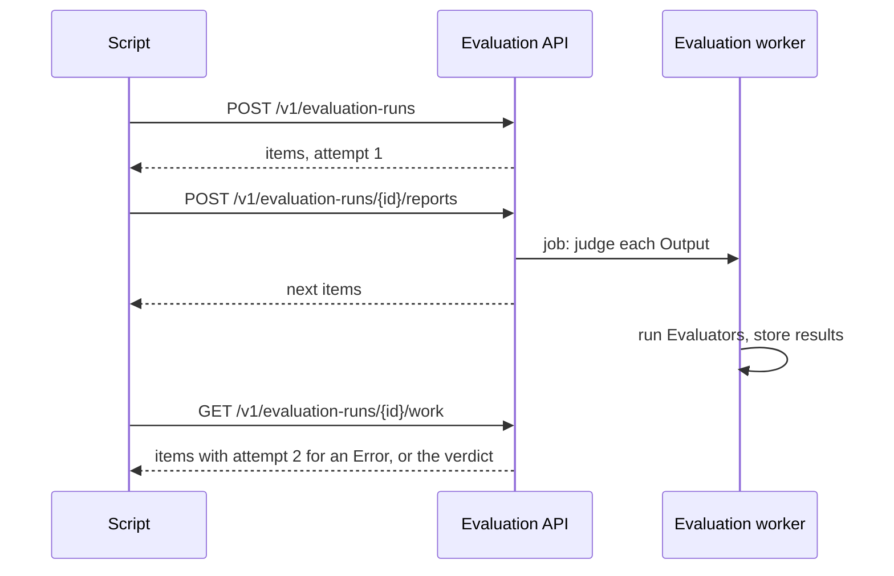

# Client-Driven Execution is a pull protocol with retries offered by the server

In Client-Driven Execution the user's script calls the application, so the platform cannot repeat a
failed call. It still has to apply one rule to every run: an Iteration with an Error is retried up
to two times. We made the script a client that repeatedly asks what to do next. Starting a run,
reporting results and reading the run's state all answer with the same document, which holds the
next Iterations to run and, once there is one, the verdict.

A retry is an Iteration that comes back with a higher `attempt`. The script contains one loop and no
retry logic, and the platform keeps every attempt, including what a later attempt replaced.

## Considered Options

- **Pull with server-offered retries (chosen):** the rule for retries lives in one place, and a
  script needs about ten requests for 150 Iterations when it reports in batches.
- **One call per report, plus explicit start, fetch and finish calls:** easier to read, but about
  160 requests for the same run, and a forgotten finish call leaves the run open.
- **Retries in the script, which reports only the final result:** the simplest API, but the platform
  could not enforce the rule and would lose the history of attempts.

## Consequences

- A run ends by itself when every Iteration has a result. `POST .../finish` exists only to stop
  early, and a run without a report for 24 hours (configurable) ends the same way. The limit counts
  from the last report, so a run may take far longer as long as the script keeps reporting.
- Work is not reserved. Two scripts on one run receive the same Iterations, and the second report of
  an attempt is refused unless it is identical. Add leases before supporting that.
- Reports are idempotent, so a batch whose response was lost can be sent again.
- Any Error uses up an attempt, including a regular expression that timed out, even though the same
  pattern may time out again. One rule is easier to explain than a list of exceptions.
- A job lost between the database and the queue is harmless: the worker queues attempts that have
  waited too long again, and judging an attempt twice changes nothing.
