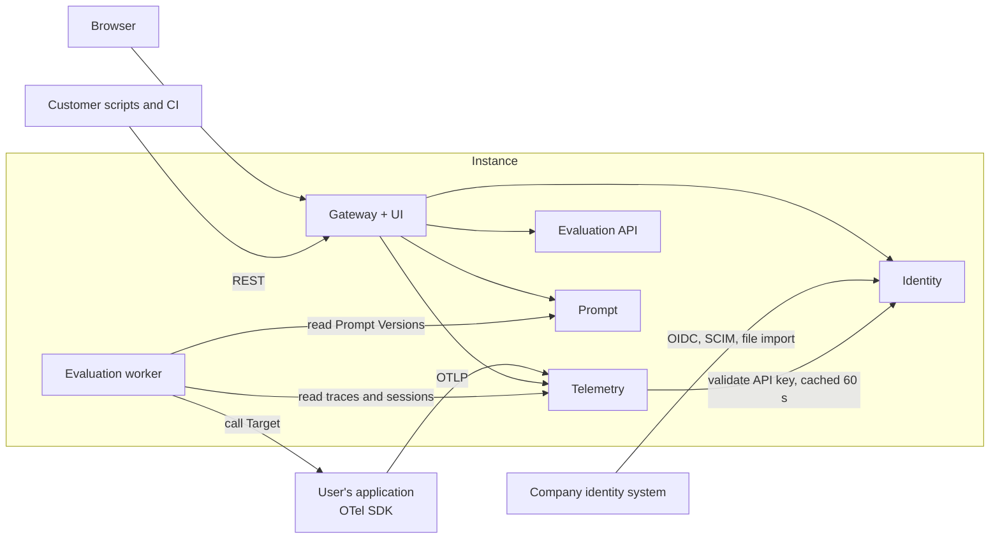
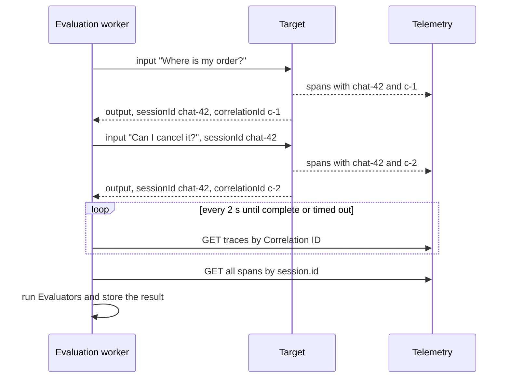

# Architecture

**Status:** accepted on 2026-11-06, including the repository structure.

Evaluation Telemetry is a self-hosted platform for observing and evaluating GenAI applications and agents. Terms in this document are defined in [GLOSSARY.md](../GLOSSARY.md). The original requirements are in [business.md](business.md).

## 1. Scope

**In v1:**

- OTLP ingestion of traces, logs and metrics, with a public REST API and a web UI
- Datasets, Evaluation Runs, Evaluators, LLM Summaries and Reports
- Versioned prompts
- Projects, Groups and Roles, with users imported from the company's identity system
- A scalable production deployment and a single-image local deployment

**Not in v1:**

- Hosting several companies on one Instance
- A replacement for infrastructure monitoring: PromQL, alerting and custom dashboards
- A built-in scheduler for Evaluation Runs: customers trigger runs from their own CI or cron
- Evaluation of production traffic: only Evaluation Runs are evaluated
- LLM-simulated users in Session Test Cases
- Vault integrations and Terraform modules

**Capacity target:** 5,000 spans per second per Instance, with 30 days of retention by default. This is an assumption that has not been measured, because performance tests are deferred (see [Quality](#11-quality)).

## 2. System overview



| Service | Owns | Deployed as |
|---|---|---|
| **Telemetry** | OTLP ingestion, traces, logs, metrics, Sessions, retention | One scalable service for both ingestion and queries |
| **Evaluation** | Datasets, Test Cases, Evaluation Runs, results, LLM providers, Reports | API and worker, scaled separately |
| **Prompt** | Prompts, Prompt Versions, Prompt Labels | API |
| **Identity** | Users, Groups, Projects, Role assignments, API keys, tokens | API |
| **Gateway + UI** | Entry point for REST and the UI, combined OpenAPI document | Proxy and static web app |

### Service rules

- A service changes only its own data and reaches other services only through their contracts.
- Services never read another service's tables.
- Each service has its own logical database and connection string. By default, one PostgreSQL server hosts all four databases. Telemetry can move to its own server through configuration alone.
- There is no event broker in v1. Services communicate through synchronous HTTP calls, and the job queue is private to Evaluation. See [ADR 0003](adr/0003-independent-services-without-a-broker.md).

### Deleting a Project

1. Identity marks the Project as deleted, so access stops at once.
2. Each service periodically asks Identity for deleted Projects and removes their data.
3. The UI shows deletion progress for each service.

## 3. Technology

| Concern | Choice |
|---|---|
| Runtime and language | Deno, TypeScript |
| HTTP and API contracts | Hono, `@hono/zod-openapi` |
| gRPC | `@grpc/grpc-js` |
| Persistence | MikroORM, with PostgreSQL in production and SQLite in the local image, see [ADR 0002](adr/0002-postgresql-and-sqlite-instead-of-mongodb.md) |
| Job queue | pg-boss in production and a small SQLite queue in the local image, see [ADR 0001](adr/0001-pg-boss-for-evaluation-job-queue.md) |
| UI | React, Vite, ECharts |
| Delivery | Docker images, Helm chart, GitHub Actions |

## 4. Telemetry

### Ingestion

- OTLP is accepted as protobuf or JSON over HTTP and as protobuf over gRPC. OTLP/gRPC does not carry JSON, so JSON means HTTP only.
- OTLP traffic goes directly to Telemetry and bypasses the Gateway because of its volume and gRPC.
- The API key on the request determines the Project.
- A batch is acknowledged only after it is stored. If the database cannot keep up, Telemetry returns a retryable response and the exporter retries. There is no intermediate buffer in v1.

### Correlation ID and Session

The user's application assigns both values. The platform never generates them.

| Attribute | Applies to | Rule |
|---|---|---|
| `correlation.id` | Spans, and logs that have a `trace_id` | Required. Records without it are rejected through OTLP `partial_success`, and the rejected count is shown in the UI. A log without a `trace_id`, such as a startup message, is stored as uncorrelated. |
| `session.id` | Spans | Optional. A Session exists as soon as its first trace arrives. |
| Neither | Metrics | Not required, because a per-call value would make metric cardinality unmanageable. |

The check runs on every record because spans of one trace can arrive in different batches. A short span processor in the application copies both values from OTel baggage onto every span. The TypeScript helper package provides this, and `examples/` shows it in Python.

### Queries

- **Traces:** waterfall and span details, inspired by MLflow.
- **Logs:** time range, attribute filters and full-text search, inspired by Loggly.
- **Metrics:** metric, filters, `sum`, `avg`, `rate`, `p95` and grouping, inspired by Grafana's query builder.
- **Retention:** configurable per Project, 30 days by default.

Telemetry storage sits behind its own interface, so another store such as ClickHouse can be added if measurements show a need for it.

## 5. Evaluation

### Execution modes

Both modes share one contract: each step of an Iteration produces an `output`, a `correlationId` and optionally a `sessionId`.

- **Server-Driven Execution:** the worker calls the Target.
- **Client-Driven Execution:** the user's script fetches Test Cases through the API, runs the application and reports the same three fields.

### One Session Test Case Iteration



### When a trace is complete

OTLP span delivery carries no end-of-trace signal, so established systems use timers. This design follows Honeycomb Refinery's root-span rule, adapted for evaluation.

- A trace is complete when its root span has been stored for at least 10 seconds. The delay covers spans from other services, because OTel SDKs export batches every 5 seconds by default.
- If no root span arrives within 60 seconds after the application's Output, the Iteration ends as Error. Evaluating partial data could produce a false failure.
- Spans that arrive after evaluation are stored and flagged, and they do not change the verdict.
- A Session Test Case needs no idle timer, because its last step marks its end.

Both timers are configurable.

### Protection against mixed telemetry

An Iteration ends as Error when its `session.id` or Correlation ID:

- already has telemetry that the platform received before the Iteration started, or
- is used by another Iteration of the same Evaluation Run.

Without this check, a reused Session could let an Iteration pass because of a tool call made by an earlier Iteration. Comparing the platform's receive times avoids problems with skewed client clocks. A retried Iteration is expected to produce new values.

### Evaluators

| Evaluator | Trace Test Case | Session Test Case |
|---|---|---|
| **Regex** | The Output | The last Output by default, or any step |
| **Grading** | The prompt and Transcript | The prompt and whole Transcript. Spans are added only when configured. |
| **Telemetry** | Spans of that trace | Spans of all traces with that `session.id` |

### Results

- An Iteration is `passed`, `failed` or `error`. It passes only if all its Evaluators pass.
- An Iteration with an Error is retried up to two times. If the Error persists, the Test Case ends as `error`: it does not count as a failure, but the Evaluation Run is not successful.
- A Test Case passes when the share of passed Iterations reaches its Pass Threshold, which defaults to 100%.
- Results keep a copy of everything needed to display them: Output, verdict, reason, the text of the Prompt Version, Correlation ID and a summary of matched spans. They stay readable after telemetry retention expires, and the UI then shows that the trace is no longer available.
- A finished run's verdicts never change.

### LLM providers

Providers declare capabilities: **Text Generation** and **Judgment**. V1 includes OpenAI-compatible (including Azure and local models), Anthropic and TypeSafe adapters. TypeSafe Jev accepts a state and typed questions, not free-form prompts, so a Grading Evaluator using it has its own configuration. LLM Summaries need Text Generation.

### Reports

When an Evaluation Run ends, Evaluation can send a Report by email over the customer's SMTP server, or to Teams through a Workflows webhook. Each Project chooses "always" or "only on failure". Delivery failures are retried through the job queue and never change the run's result.

## 6. Prompts

Prompt Versions are immutable and numbered automatically. Prompt Labels such as `production` can move between versions. Versions can be compared by text and model parameters. Evaluators and LLM Summaries reference a specific version, so a run can be repeated.

## 7. Access and security

### Identity

- **OIDC** signs users in.
- **SCIM 2.0** keeps users and Groups in sync between sign-ins.
- **JSON or CSV import** serves companies without SCIM.
- **Local accounts** exist only in the local image.
- Permissions are not imported. A company's group is mapped to a Group, and a Project admin assigns it a Role: `viewer`, `editor` or `admin`.

### Requests

- **UI and REST:** Identity issues a short-lived JWT carrying Roles. Each service verifies its signature locally.
- **OTLP:** Telemetry validates the Project API key with Identity and caches the result for 60 seconds, so a revocation takes effect within a minute.
- **Service to service:** each service obtains a short-lived token from Identity. The worker uses it to read Telemetry and Prompt data for the Project it is evaluating.

### Secrets

LLM provider keys and Target credentials are encrypted in the Evaluation database with AES-256-GCM. The master key comes from a Kubernetes Secret or environment variable. The local image generates it into `/data` on first start.

### Known risks to design for

- **Requests to internal addresses:** Targets are user-supplied URLs, so the worker could be pointed at internal services. It needs an allowlist of permitted destinations.
- **Slow regular expressions:** user-supplied patterns can run for a long time. They need to run in a Web Worker that can be terminated on timeout.

## 8. Web UI

The UI is a React single-page application with English text that talks only to the Gateway. Observability and evaluation share one interface.

## 9. Deployment

### Production

- One image per service, deployed by one Helm chart to OpenShift, AKS or EKS.
- The customer provides PostgreSQL. The chart does not install it.
- Containers run as non-root with an arbitrary UID, as OpenShift requires by default.
- gRPC holds long-lived HTTP/2 connections, so OTLP/gRPC needs an L7 load balancer or client-side balancing.
- All services ship as one version set. Within `/v1`, contract changes must be backward compatible so that rolling updates work.

### Local image

The `all-in-one` image has no external dependencies. All services run in one process, each with its own SQLite file in `/data`. Calls between services reuse the same request handlers without a network:

```ts
// Production: Evaluation calls Telemetry over the network
const telemetryClient = createHttpClient(environment.TELEMETRY_URL);

// Local image: the same contract without a network
const telemetryService = createTelemetryService({ databasePath: "/data/telemetry.sqlite" });
const telemetryClient = createInProcessClient(telemetryService.handleRequest);
```

## 10. Repository structure

Approved on 2026-11-06. The repository is one Deno workspace.

```text
.
├── CLAUDE.md
├── GLOSSARY.md
├── README.md
├── deno.json
├── services/
│   ├── telemetry/
│   │   ├── src/
│   │   │   ├── main.ts              # Starts the service on its own
│   │   │   ├── create-service.ts    # Builds the service from its dependencies
│   │   │   ├── ingestion/
│   │   │   ├── traces/
│   │   │   ├── logs/
│   │   │   ├── metrics/
│   │   │   ├── sessions/
│   │   │   ├── retention/
│   │   │   └── storage/
│   │   ├── migrations/
│   │   │   ├── postgres/
│   │   │   └── sqlite/
│   │   └── tests/
│   ├── evaluation/
│   │   └── src/
│   │       ├── main-api.ts
│   │       ├── main-worker.ts
│   │       ├── create-service.ts
│   │       ├── datasets/
│   │       ├── evaluation-runs/
│   │       ├── iterations/
│   │       ├── evaluators/
│   │       ├── targets/
│   │       ├── llm-providers/
│   │       ├── reports/
│   │       └── job-queue/
│   ├── prompt/
│   ├── identity/
│   └── gateway/
├── apps/
│   ├── web/                         # React UI
│   └── all-in-one/                  # Local image: runs all services in one process
├── packages/
│   ├── contracts/                   # API schemas for each service
│   ├── service-client/              # HTTP and in-process clients
│   ├── service-runtime/             # Shared config, logging and token verification
│   └── telemetry-ids/               # Public helper for Correlation ID and session.id
├── examples/
│   ├── typescript/
│   └── python/
├── tests/
│   └── e2e/
├── deploy/
│   ├── docker/
│   ├── compose/
│   └── helm/
├── docs/
│   ├── business.md
│   ├── architecture.md
│   └── adr/
└── .github/workflows/
```

Import rules, enforced in CI:

- A service may import `packages/*`, but never another service.
- Modules inside a service import each other only through their public entry points.
- Only `apps/all-in-one` may import several services, and only their `create-service.ts`.
- `packages/` holds contracts and technical helpers, never domain logic.

## 11. Quality

This repository's GitHub Actions pipeline runs on every pull request. It checks lint, formatting, types and import rules, and runs unit tests and e2e tests in both deployments.

Performance tests from the business specification are deferred to avoid their cost for now:

- A dedicated machine for checking the capacity target is never free.
- A nightly regression test would be free only in a public repository.

They can be added to `tests/performance/` later.

Code, tests, examples, documentation and operations are written in English. Names must state their purpose, and single-letter names are not allowed.

### What has been verified

These small tests ran on 2026-11-04 on macOS with Deno 2.9.5. They show that the pieces work together. They are not benchmarks.

| Tested | Result |
|---|---|
| gRPC server with `@grpc/grpc-js` 1.14 and a Node client | Unary calls, a 3 MB payload, error status and 2,000 concurrent calls worked, locally and without TLS |
| MikroORM 7.2.6 on PostgreSQL and SQLite | One entity worked on both, including JSON attribute filters and grouping |
| MikroORM 7.2.6 on MongoDB | Filtering on a dotted attribute such as `gen_ai.request.model` silently returned no records, and grouping needed a separate pipeline |
| pg-boss 12.38 and BullMQ 6.5.4 | Both processed all jobs with a retry, see [ADR 0001](adr/0001-pg-boss-for-evaluation-job-queue.md) |
| Correlation ID and Session propagation with an OTel span processor | All 6 spans in 2 traces reached a local OTLP receiver with the right values |
| Hono handler over HTTP and called directly | Same response on one endpoint, with validation and OpenAPI 3.1 generation |
| React 19 and Vite 7 build | A minimal page built successfully |

### What has not been verified

- `better-sqlite3` inside the `all-in-one` image
- gRPC ingestion with a real OTel exporter and TLS
- MikroORM migrations on PostgreSQL and SQLite
- The capacity target of 5,000 spans per second
- pg-boss under sustained load, in a container and on a managed PostgreSQL service
- Automated enforcement of the import rules

### First implementation step

Build one thin path through the whole system in both deployments: an OTLP span goes through ingestion and storage, can be read through the API and appears in the UI. This resolves the first two unverified items before more code depends on them.

## 12. Decision records

- [ADR 0001: pg-boss for the Evaluation job queue](adr/0001-pg-boss-for-evaluation-job-queue.md)
- [ADR 0002: PostgreSQL and SQLite instead of MongoDB](adr/0002-postgresql-and-sqlite-instead-of-mongodb.md)
- [ADR 0003: Independent services without a broker](adr/0003-independent-services-without-a-broker.md)
