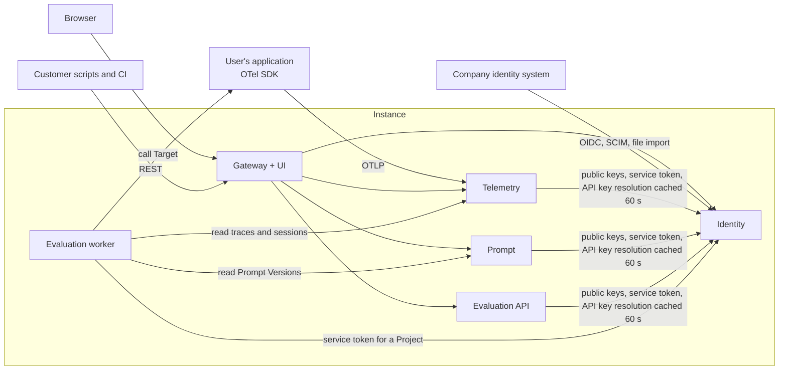
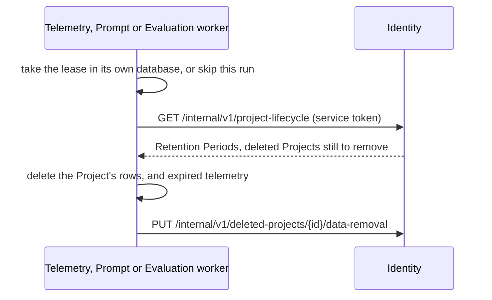
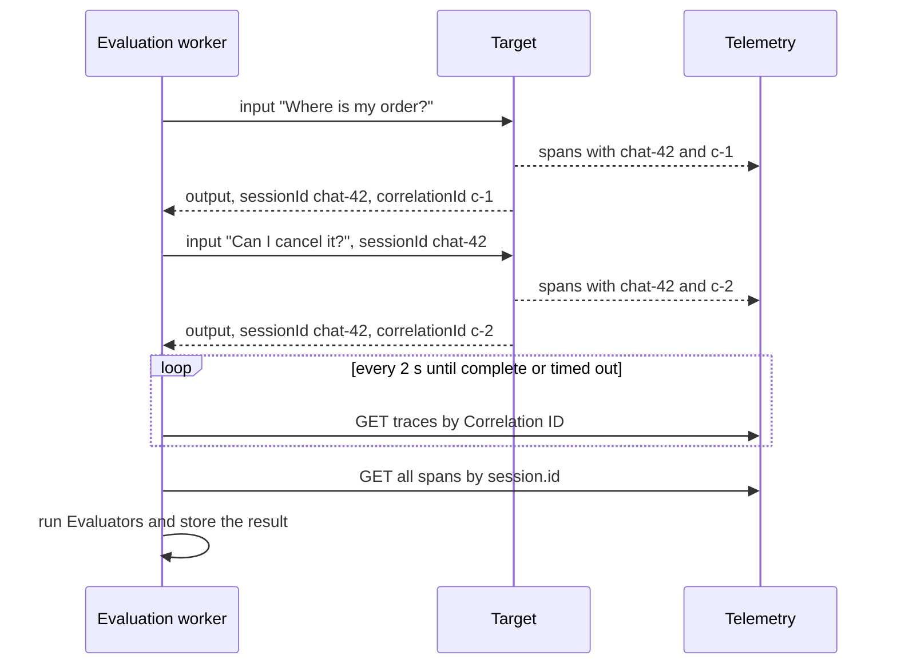
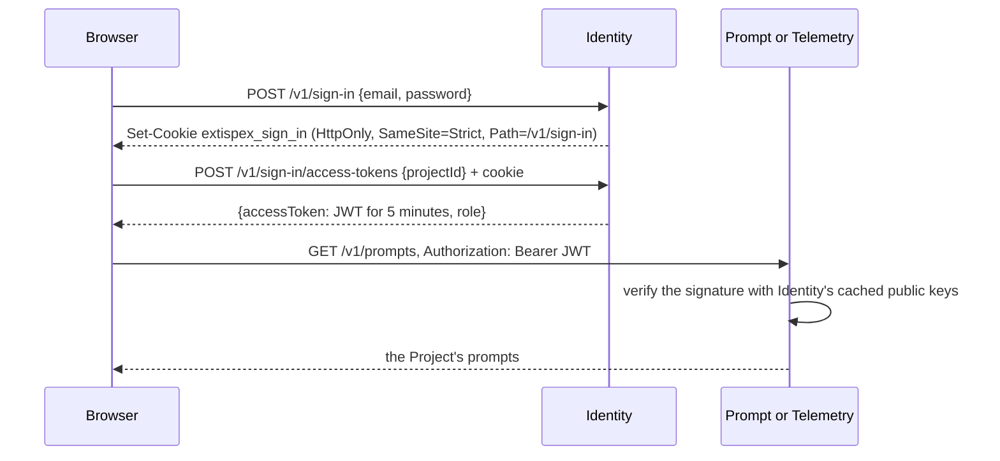
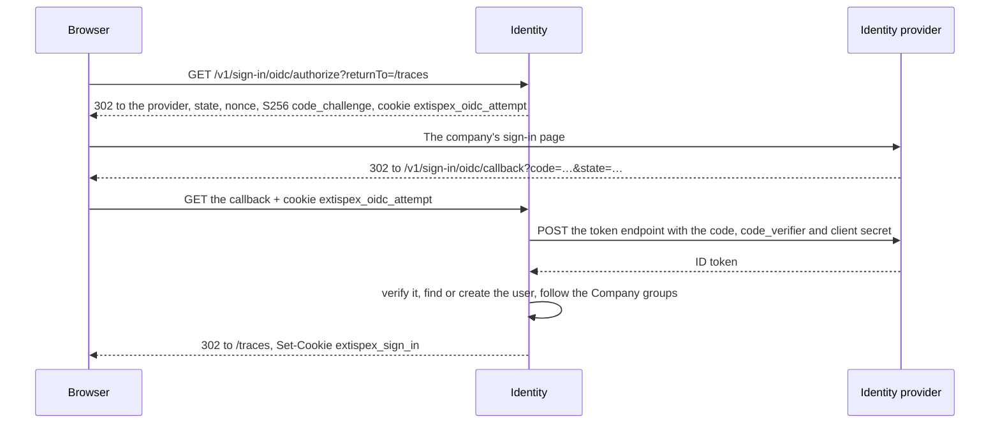

# Architecture

**Status:** accepted on 2026-11-06, including the repository structure.

Extispex is a self-hosted platform for observing and evaluating GenAI applications and agents. Terms
in this document are defined in [GLOSSARY.md](../GLOSSARY.md). The original requirements are in
[business.md](business.md).

## 1. Scope

**In v1:**

- OTLP ingestion of traces, logs and metrics, with a public REST API and a web UI
- Datasets, Evaluation Runs, Evaluators, LLM Summaries and Reports
- Versioned prompts
- Projects, Groups and Roles, with users imported from the company's identity system
- A scalable production deployment and a single-image local deployment

**Not in v1:**

- Hosting several companies on one Instance
- A replacement for infrastructure monitoring: PromQL, alerting and custom dashboards
- A built-in scheduler for Evaluation Runs: customers trigger runs from their own CI or cron
- Evaluation of production traffic: only Evaluation Runs are evaluated
- LLM-simulated users in Session Test Cases
- Vault integrations and Terraform modules

**Capacity target:** 5,000 spans per second per Instance, with 30 days of retention by default. This
is an assumption that has not been measured, because performance tests are deferred (see
[Quality](#11-quality)).

## 2. System overview



| Service          | Owns                                                                   | Deployed as                                         |
| ---------------- | ---------------------------------------------------------------------- | --------------------------------------------------- |
| **Telemetry**    | OTLP ingestion, traces, logs, metrics, Sessions, retention             | One scalable service for both ingestion and queries |
| **Evaluation**   | Datasets, Test Cases, Evaluation Runs, results, LLM providers, Reports | API and worker, scaled separately                   |
| **Prompt**       | Prompts, Prompt Versions, Prompt Labels                                | API                                                 |
| **Identity**     | Users, Groups, Projects, Role assignments, API keys, tokens            | API                                                 |
| **Gateway + UI** | Entry point for REST and the UI, combined OpenAPI document             | Proxy and static web app                            |

### Service rules

- A service changes only its own data and reaches other services only through their contracts.
- Services never read another service's tables.
- Each service has its own logical database and connection string. By default, one PostgreSQL server
  hosts all four databases. Telemetry can move to its own server through configuration alone.
- There is no event broker in v1. Services communicate through synchronous HTTP calls, and the job
  queue is private to Evaluation. See [ADR 0003](adr/0003-independent-services-without-a-broker.md).

### Deleting a Project

Built in roadmap step 13. See [ADR 0018](adr/0018-data-lifecycle-through-leased-periodic-runs.md).

1. Identity marks the Project as deleted, so access stops at once: API keys within a minute, access
   tokens within five minutes.
2. Each service periodically asks Identity for deleted Projects and removes their data.
3. The UI shows deletion progress for each service.



- **Data lifecycle:** every service runs it every `DATA_LIFECYCLE_INTERVAL_MILLISECONDS`, ten
  minutes by default; Evaluation in its worker. A lease row (`background_leases`) taken by
  compare-and-set lets one replica at a time run it, on SQLite and PostgreSQL alike. It lasts two
  intervals and its holder renews it on each run.
- **Final removal:** a token issued before the deletion can still write for five minutes, so
  Identity lists a deleted Project to a service until that service removed its data at least five
  minutes after the deletion. `GET /v1/deleted-projects` shows each service as waiting, removing or
  removed, and the Projects page shows it to Instance admins.
- **What goes:** Identity removes the Project's API keys and Role assignments and keeps the Project
  row; Telemetry its spans, Log Records, Time Series, points and rejected counts; Prompt its
  prompts; Evaluation its Datasets, Evaluation Runs with their results, and Targets.

## 3. Technology

| Concern                | Choice                                                                                                                                      |
| ---------------------- | ------------------------------------------------------------------------------------------------------------------------------------------- |
| Runtime and language   | Deno, TypeScript                                                                                                                            |
| HTTP and API contracts | Hono, `@hono/zod-openapi`                                                                                                                   |
| gRPC                   | `@grpc/grpc-js`                                                                                                                             |
| Persistence            | MikroORM, with PostgreSQL in production and SQLite in the local image, see [ADR 0002](adr/0002-postgresql-and-sqlite-instead-of-mongodb.md) |
| Job queue              | pg-boss in production and a small SQLite queue in the local image, see [ADR 0001](adr/0001-pg-boss-for-evaluation-job-queue.md)             |
| UI                     | React, React Router in declarative mode, Vite, ECharts                                                                                      |
| Browser tests          | `playwright-core` with headless Chromium, see [ADR 0005](adr/0005-playwright-browser-tests-with-layout-rules.md)                            |
| Delivery               | Docker images, Helm chart, GitHub Actions                                                                                                   |

## 4. Telemetry

### Ingestion

- OTLP is accepted as protobuf or JSON over HTTP and as protobuf over gRPC. OTLP/gRPC does not carry
  JSON, so JSON means HTTP only.
- Both protocols accept gzip and deflate, the encodings that OpenTelemetry SDKs and the Collector
  offer by default. OTLP/HTTP decompresses with `DecompressionStream` and answers any other
  `Content-Encoding` with `415` and an `Accept-Encoding` header. grpc-js decompresses OTLP/gRPC
  messages before the handler sees them.
- One export request may hold up to 32 MiB after decompression on both protocols, so a batch that
  one protocol accepts is never refused by the other. OTLP/HTTP counts bytes while it decompresses
  and stops at the limit, so a small compressed body cannot fill the memory. grpc-js also checks
  `grpc.max_receive_message_length` after decompression; its default of 4 MiB is raised to the same
  limit.
- OTLP traffic goes directly to Telemetry and bypasses the Gateway because of its volume and gRPC.
- The API key, or the access token's Project, on the request determines the Project.
- A batch is acknowledged only after it is stored. If the database cannot keep up, Telemetry returns
  a retryable response and the exporter retries. There is no intermediate buffer in v1.

### Correlation ID and Session

The user's application assigns both values. The platform never generates them.

| Attribute        | Applies to                             | Rule                                                                                                                                                                                                   |
| ---------------- | -------------------------------------- | ------------------------------------------------------------------------------------------------------------------------------------------------------------------------------------------------------ |
| `correlation.id` | Spans, and logs that have a `trace_id` | Required. Records without it are rejected through OTLP `partial_success`, and the rejected count is shown in the UI. A log without a `trace_id`, such as a startup message, is stored as uncorrelated. |
| `session.id`     | Spans                                  | Optional. A Session exists as soon as its first trace arrives.                                                                                                                                         |
| Neither          | Metrics                                | Not required, because a per-call value would make metric cardinality unmanageable.                                                                                                                     |

The check runs on every record because spans of one trace can arrive in different batches. A short
span processor in the application copies both values from OTel baggage onto every span. The
TypeScript helper package provides this, and `examples/` shows it in Python.

### Logs

Built in roadmap step 11. See [ADR 0012](adr/0012-daily-log-partitions-on-the-record-time.md) for
the table layout.

- **Time:** a Log Record's time is OTLP's `time_unix_nano`, or else `observed_time_unix_nano`, as
  OTLP advises, or else the receive time. A record more than 30 days old or more than one day ahead
  is rejected.
- **Correlation:** a Log Record with a `trace_id` needs `correlation.id`. OTLP says that a malformed
  `trace_id` means no trace, so such a record is stored as an Uncorrelated Log.
- **Retried batches:** OTLP has no ID for a Log Record, so its ID is the SHA-256 of its content. An
  exporter's retry stores nothing twice, and Loki also merges identical lines at one timestamp.
- **Storage:** PostgreSQL has daily partitions and a `tsvector` with the `simple` configuration.
  SQLite has one table and FTS5 keeping diacritics. Both index the first 65,536 characters of the
  body, because PostgreSQL refuses a `tsvector` above 1 MiB. Words are split slightly differently:
  PostgreSQL keeps a host name or an email address as one word, and SQLite splits it at punctuation.
- **Text that cannot be stored:** U+0000 and lone surrogates are removed from Log Records, because
  PostgreSQL refuses them and one such value would fail its batch on every retry.
- **Rejected records:** ingestion adds spans and Log Records it rejects to a count per Project,
  signal and hour. `GET /v1/rejected-telemetry` returns the last 24 hours, and the Traces and Logs
  pages show it. A count that cannot be written is logged and does not fail the export.

### Metrics

Built in roadmap step 12. See
[ADR 0015](adr/0015-metric-time-series-stored-once-and-cumulative-values-at-query-time.md) for the
storage and the query.

- **Accepted:** sums, gauges and explicit-bucket histograms, cumulative or delta. Exponential
  histograms and summaries are rejected through `partial_success` and counted like rejected spans,
  as are points with an unspecified temporality, no time, a value that is not finite, a name longer
  than 255 characters or a time outside the same 30-day window as Log Records. A point flagged as
  having no recorded value is skipped.
- **Time Series:** a Time Series is stored once in `metric_series`, keyed by a SHA-256 of the
  Metric's name, type, unit, temporality, monotonicity, scope, histogram bounds and both attribute
  sets with sorted keys. Its points in `metric_points` refer to it, and a retried batch stores
  nothing twice. On PostgreSQL the points have daily partitions, created as for logs.
- **Cumulative values** are turned into increases when a query reads them, with `lag()` on both
  databases: an increase is the difference to the point before, or the whole value after a reset,
  which shows as a falling value or a new start time. A point looks back at most ten minutes, or one
  step if that is longer, for the point before it. Without one, it counts only when its own start
  time lies in that window; otherwise nothing says how much of its value falls into the query's time
  range. Ingestion keeps no state per Time Series.
- **Aggregations:** a monotonic sum and a delta sum are added up as increases: `sum` per step, `avg`
  per point and `rate` per second. A gauge and a cumulative non-monotonic sum are levels: `sum` adds
  each Time Series' average in the step and `avg` averages all points; `rate` does not apply. A
  histogram supports `sum` and `avg` of its observations, `rate` of its count and `p95`.
- **`p95`** is computed in TypeScript from the bucket counts, by linear interpolation inside the
  bucket that holds the quantile, as Prometheus's `histogram_quantile` does, so both databases give
  the same answer. Histograms of several Time Series are added bucket by bucket first; with
  different bounds the counts merge at the union of the bounds and are only as precise as the
  coarsest. A quantile in the overflow bucket is reported as the largest finite bound.
- **Steps** are aligned to the clock and chosen from the time range, at least 60 seconds, the OTel
  SDKs' default export interval. The last step's rate is divided by the part of it inside the range.
- **Limits:** a query refuses a Metric with more than 20,000 Time Series, more than 2,000 after its
  filters, more than 1,000 steps or more than 100,000 rows read, and says how to narrow it.

### Queries

- **Traces:** waterfall and span details, inspired by MLflow.
- **Logs:** time range, attribute filters and full-text search, inspired by Loggly. `GET /v1/logs`
  answers newest first with a `nextCursor`. `search` finds whole words in the body, all of them, and
  `attribute=key=value` may be repeated.
- **Metrics:** metric, filters, `sum`, `avg`, `rate`, `p95` and grouping, inspired by Grafana's
  query builder. `GET /v1/metrics` lists the Metrics with the aggregations each supports,
  `GET /v1/metrics/attributes` a Metric's attribute keys, and `GET /v1/metrics/query` answers one
  value per step for each group. Filters and grouping read an attribute of the data point, or else
  of the application that sent it, such as `service.name`.
- **Retention:** each Project has a Retention Period, 30 days by default and from 1 to 400, which
  its `admin` sets on the Project's page (`PATCH /v1/projects/{projectId}`). Telemetry's data
  lifecycle deletes spans by their start time and Log Records and metric points by their time once
  they are older than it, Time Series last seen before it, and rejected counts after 24 hours. On
  PostgreSQL a whole day is dropped once it is past the longest Retention Period of any Project and
  the 30-day ingestion window; Projects with a shorter period lose rows. Results of Evaluation Runs
  keep their own copy, and the UI says that their traces are no longer available once the Retention
  Period has passed. See [ADR 0018](adr/0018-data-lifecycle-through-leased-periodic-runs.md).

Telemetry storage sits behind its own interface, so another store such as ClickHouse can be added if
measurements show a need for it.

## 5. Evaluation

### Execution modes

Both modes share one contract: each step of an Iteration produces an `output`, a `correlationId` and
optionally a `sessionId`.

- **Server-Driven Execution:** the worker calls the Target.
- **Client-Driven Execution:** the user's script fetches Test Cases through the API, runs the
  application and reports the same three fields.

### Server-Driven Execution

Built in roadmap step 6, together with Session Test Cases.

A Target is a URL with an optional credential, one HTTP header such as `Authorization`, which is
stored encrypted (see [Secrets](#secrets)) and never returned. Every step of an Iteration is one
call with a fixed contract:

```http
POST https://agent.company.example/evaluate
Authorization: Bearer …
{ "input": { "message": "Can I cancel it?" }, "sessionId": "chat-42" }

200 { "output": "Yes, within 24 hours.", "correlationId": "c-2", "sessionId": "chat-42" }
```

- **Starting:** `POST /v1/evaluation-runs` with `executionMode: "server"` and a `targetName`. The
  run keeps the Target's ID and name; a change to the Target applies from the next call, and a
  deleted Target ends the remaining attempts as Error.
- **Calls:** the worker gets one job per attempt. Any answer other than 2xx with an `output` and a
  `correlationId`, a redirect, a timeout (`EVALUATION_TARGET_TIMEOUT_MILLISECONDS`, 60 seconds per
  call) or an answer above 4 MB is an Error, and the usual retries apply. A worker handles four jobs
  at once, calls and evaluations together.
- **One call per attempt:** a worker claims an attempt with one conditional update and renews the
  claim every 30 seconds while it calls the Target. A second delivery of the same job finds the
  claim and does nothing. A claim that is not renewed for two minutes means the worker died; the
  maintenance task queues the attempt again, and the Target is then called again.
- **Allowed destinations:** `EVALUATION_TARGET_ALLOWED_DESTINATIONS` lists host names, `host:port`,
  `*.wildcard` names and CIDR ranges, for example
  `agent.company.example:443,*.internal.company.example,10.20.0.0/16`. Separate services allow
  nothing by default; the local image allows `*`. A listed name may resolve to a private address,
  because internal Targets are the usual case, but not to the machine itself, a link-local address
  such as a cloud metadata service, or multicast, unless a CIDR range allows it. Every address a
  name resolves to must be allowed. The worker resolves the name once and connects to exactly the
  checked addresses, so a DNS record that changes in between cannot redirect the call. Redirects are
  not followed. An HTTPS Target's certificate is checked against its host name; a private
  certificate authority is added with `NODE_EXTRA_CA_CERTS`.

### Session Test Cases

A Session Test Case has `steps` instead of an `input`. Each step is sent in order within one
Session: the first call has no `sessionId`, and later calls carry the one the Target returned. The
Target must return the same `sessionId` for every step.

```json
{
  "name": "cancel-order",
  "scope": "session",
  "steps": [
    { "input": { "message": "Where is my order?" } },
    { "input": { "message": "Can I cancel it?" } }
  ],
  "evaluators": [
    { "type": "regex", "name": "first-answer", "pattern": "ships today", "step": 1 },
    {
      "type": "telemetry",
      "name": "cancelled",
      "match": { "name": "execute_tool", "attributes": { "gen_ai.tool.name": "cancel_order" } }
    }
  ]
}
```

- **Evaluators:** a Regex Evaluator matches the last step's Output, or the step it names. A
  Telemetry Evaluator counts the spans of every trace with the Session's `session.id`, read from
  `GET /internal/v1/sessions/{sessionId}/spans`.
- **Completion:** every step's Correlation ID must have a complete trace, by the same root-span rule
  as one trace, timed from the end of the last step. Every step's Correlation ID is marked
  evaluated.
- **Mixed telemetry:** the Session and every step's Correlation ID are checked, including the
  Correlation IDs of other attempts' earlier steps, which `iteration_attempt_steps` keeps.
- **Client-Driven Execution:** a work item carries `scope` and `steps`, and the script reports all
  steps at once, so that repeating an identical report still changes nothing. A report with the
  wrong number of steps or different `sessionId`s is refused as `invalid_report`. An error report
  may carry the steps that worked before the failure.
- **Transcript:** each attempt in the results has a `transcript` with every step's input, Output and
  IDs; the attempt's own `output`, `correlationId` and `sessionId` are the last step's.

### One Session Test Case Iteration



### When a trace is complete

OTLP span delivery carries no end-of-trace signal, so established systems use timers. This design
follows Honeycomb Refinery's root-span rule, adapted for evaluation.

- A trace is complete when its root span has been stored for at least 10 seconds. The delay covers
  spans from other services, because OTel SDKs export batches every 5 seconds by default.
- If no root span arrives within 60 seconds after the application's Output, the Iteration ends as
  Error. Evaluating partial data could produce a false failure.
- Spans that arrive after evaluation are stored and flagged, and they do not change the verdict.
- A Session Test Case needs no idle timer, because its last step marks its end.

Both timers are configurable: `EVALUATION_ROOT_SPAN_SETTLE_MILLISECONDS` and
`EVALUATION_ROOT_SPAN_TIMEOUT_MILLISECONDS`, with Telemetry asked every
`EVALUATION_TELEMETRY_POLL_INTERVAL_MILLISECONDS` (2 seconds by default).

Built in roadmap step 5:

- **Only Test Cases with a Telemetry Evaluator wait.** An Output alone cannot be incomplete, so a
  Test Case with only Regex Evaluators is judged at once and needs no telemetry.
- **Several traces:** a Correlation ID can have several traces, for example after a retry. Each one
  needs a root span, and the latest root span must have been stored for 10 seconds. A root span that
  arrives just before the timeout still gets its full 10 seconds.
- **No job waits in a worker slot.** A job that has to wait queues itself again with a delay, so
  waiting Iterations do not hold back the others. Its age comes from the stored time of the Output,
  so the job carries no state.
- **Clocks:** Telemetry answers with its own current time, `readAt`, so the 10 seconds are measured
  on one clock.
- **Telemetry unavailable:** the attempt keeps waiting until the 60-second timeout, then ends as
  Error.
- **Telemetry's internal API** is `GET /internal/v1/correlations/{id}`, `.../spans`,
  `POST .../evaluated` and `GET /internal/v1/sessions/{id}`. The Gateway does not forward them.
  Telemetry's port is open to OTLP exporters, so they take only a service token for the Project. A
  user's token or an API key gets `401`, even with the Role `admin`.
- **Marking spans as evaluated:** the worker reports the `readAt` of the spans it judged, and
  Telemetry stores it per Correlation ID. A span received later has `arrivedAfterEvaluation`, which
  is worked out when reading, so spans are never rewritten.

### Protection against mixed telemetry

An Iteration ends as Error when its `session.id` or Correlation ID:

- already has telemetry that the platform received before the Iteration started, or
- is used by another Iteration of the same Evaluation Run.

Without this check, a reused Session could let an Iteration pass because of a tool call made by an
earlier Iteration. Comparing the platform's receive times avoids problems with skewed client clocks.
A retried Iteration is expected to produce new values.

Built in roadmap step 5, and applied to Test Cases with a Telemetry Evaluator:

- **When an attempt starts:** when the platform makes it available, which is the start of the run
  for the first attempt and the end of the previous attempt for a retry. Client-Driven Execution has
  no earlier signal, because handing out work is a repeatable read.
- **Other attempts:** the first rule's "another Iteration" includes the other attempts of the same
  Iteration, so a retry that repeats its IDs ends as Error. An ID found only after another Iteration
  has already been judged ends the later Iteration as Error and leaves the earlier result alone.

### Client-Driven Execution

Built in roadmap step 4. See [ADR 0009](adr/0009-client-driven-execution-as-a-pull-protocol.md) for
the reasons.

A Test Case holds what the script needs and how to judge the Output:

```json
{
  "name": "refund-mentions-30-days",
  "scope": "trace",
  "input": { "message": "What is your refund policy?" },
  "expectedOutput": "Refunds within 30 days.",
  "evaluators": [
    { "type": "regex", "name": "mentions-days", "pattern": "30\\s*days", "flags": "i" }
  ],
  "iterations": 3,
  "passThreshold": 0.66
}
```

- **Copies:** starting a run copies its Test Cases, so editing or deleting them never changes a run.
- **The script's loop:** `POST /v1/evaluation-runs`, `POST /v1/evaluation-runs/{id}/reports` and
  `GET /v1/evaluation-runs/{id}/work` all answer with `runId`, `status`, `verdict`, `items` and
  `evaluationsInProgress`. The script runs `items` and reports them, up to the run's `batchSize` of
  at most 100. With no `items` and the status `running`, it waits for the worker.
- **Attempts:** an Error, reported by the script or found by an Evaluator, puts the Iteration back
  into `items` with the next `attempt`, up to three in total. Each attempt is stored.
- **Reports** are handled one by one, and refused ones are listed in `rejected`. Repeating an
  identical report changes nothing.
- **The end of a run:** a run finishes when every Iteration has a result. `POST .../finish` ends it
  early, and a run without a report for 24 hours ends too
  (`EVALUATION_INACTIVE_RUN_TIMEOUT_MILLISECONDS`). Evaluations may take many hours, so the limit
  counts from the last report rather than from the start. Open Iterations then end as Error, without
  retries. The run's verdict is `failed` on any failure, otherwise `error` on any Error, otherwise
  `passed`.
- **Results** are paged, so their size does not grow with the run. `GET /v1/evaluation-runs/{id}` is
  the run's state, `.../test-cases` a page of Test Case results, and
  `.../test-cases/{name}/iterations` a page of one Test Case's Iterations with their attempts. A
  page holds at most 50 entries and gives a `nextCursor`.
- **Concurrency:** every change to a run first increments its `revision`, which locks the row until
  commit, so exactly one transaction sees the last Iteration end and sets the verdicts.
- **Job queue:** the API stores a report first and queues its job afterwards. A job can be lost
  between the two, so the worker queues attempts again after two minutes, and judging an attempt
  twice changes nothing. pg-boss keeps its tables in its own schema of the Evaluation database. The
  local image polls a table in its SQLite file.
- **Regular expressions** run in a new Web Worker that is terminated after one second
  (`EVALUATION_REGEX_TIMEOUT_MILLISECONDS`). A timeout is an Error.

### Evaluators

| Evaluator     | Trace Test Case           | Session Test Case                                                      |
| ------------- | ------------------------- | ---------------------------------------------------------------------- |
| **Regex**     | The Output                | The last Output by default, or any step                                |
| **Grading**   | The prompt and Transcript | The prompt and whole Transcript. Spans are added only when configured. |
| **Telemetry** | Spans of that trace       | Spans of all traces with that `session.id`                             |

A Telemetry Evaluator counts the spans that meet its conditions, see
[ADR 0010](adr/0010-telemetry-evaluator-conditions-as-json.md):

```json
{
  "type": "telemetry",
  "name": "called-refund-tool",
  "match": {
    "name": "execute_tool",
    "status": "ok",
    "attributes": { "gen_ai.tool.name": "lookup_refund" }
  },
  "count": { "min": 1 }
}
```

`name`, `status` and `attributes` are each optional, but one is required, and attribute values are
compared exactly. `count` defaults to at least one, and `{ "min": 0, "max": 0 }` forbids such a
span. More than 10,000 spans for one Correlation ID make the attempt an Error, because judging part
of them could produce a false failure.

### Results

- An Iteration is `passed`, `failed` or `error`. It passes only if all its Evaluators pass.
- An Iteration with an Error is retried up to two times. If the Error persists, the Test Case ends
  as `error`: it does not count as a failure, but the Evaluation Run is not successful.
- A Test Case passes when the share of passed Iterations reaches its Pass Threshold, which defaults
  to 100%.
- Results keep a copy of everything needed to display them: Output, verdict, reason, the text of the
  Prompt Version, Correlation ID and a summary of matched spans. They stay readable after telemetry
  retention expires, and the UI then shows that the trace is no longer available.
- A finished run's verdicts never change.

### LLM providers

Providers declare capabilities: **Text Generation** and **Judgment**. V1 includes OpenAI-compatible
(including Azure and local models), Anthropic and TypeSafe adapters. TypeSafe Jev accepts a state
and typed questions, not free-form prompts, so a Grading Evaluator using it has its own
configuration. LLM Summaries need Text Generation.

### Reports

When an Evaluation Run ends, Evaluation can send a Report by email over the customer's SMTP server,
or to Teams through a Workflows webhook. Each Project chooses "always" or "only on failure".
Delivery failures are retried through the job queue and never change the run's result.

## 6. Prompts

Prompt Versions are immutable and numbered automatically. Prompt Labels such as `production` can
move between versions. Versions can be compared by text and model parameters. Evaluators and LLM
Summaries reference a specific version, so a run can be repeated.

### What a Prompt Version holds

A prompt is identified by its name, which is unique within its Project and never changes, so an
application reads `GET /v1/prompts/support-agent/labels/production`. A version holds either one text
or a list of chat messages with the roles `system`, `user` and `assistant`, as Langfuse and MLflow's
prompt registry do.

```json
{
  "type": "chat",
  "messages": [
    { "role": "system", "content": "You help customers of {{company}}." },
    { "role": "user", "content": "{{question}}" }
  ],
  "modelParameters": {
    "model": "gpt-4.1",
    "temperature": 0.2,
    "maxOutputTokens": 800,
    "topP": null,
    "providerOptions": { "response_format": { "type": "json_object" } }
  },
  "variables": ["company", "question"],
  "commitMessage": "Shorter system prompt"
}
```

- **Prompt Variables** are written `{{name}}`, as in Langfuse, MLflow and the OpenAI and Anthropic
  consoles. They are only replaced by values: there are no conditions or loops, so a template cannot
  run logic. The service lists each version's variables when it stores it.
- **Model parameters** have typed fields for what every LLM provider understands: `model`,
  `temperature`, `maxOutputTokens` and `topP`. The Grading Evaluator maps them to each provider in
  step 7. Anything provider-specific goes into `providerOptions`, stored as given. Unknown fields
  outside `providerOptions` are rejected, so that a misspelt parameter is not silently dropped.
- **Numbering:** adding a version increments a counter on the prompt in the same transaction, so
  concurrent additions get distinct numbers on both databases.
- **Comparison:** `GET /v1/prompts/{name}/compare?fromVersion=1&toVersion=2` first matches whole
  messages, so that an inserted message does not make every later one look changed, then compares
  messages that differ at the same position with the same role line by line. Model parameters are
  compared one by one, including each provider option.

### Public API document

The public API's routes are defined in `packages/contracts`. Each service attaches its handlers to
those definitions, and the Gateway builds its forwarding table and the combined OpenAPI document at
`/v1/openapi.json` from the same list, see
[ADR 0006](adr/0006-public-api-routes-in-shared-contracts.md).

## 7. Access and security

### Identity

- **OIDC** signs users in.
- **SCIM 2.0** keeps users and Company groups in sync between sign-ins, see
  [Directory sync](#directory-sync).
- **JSON or CSV import** serves companies without SCIM.
- **Local accounts** sign in with a password that Identity stores. The local image always enables
  them; the separate Identity service enables them with `LOCAL_ACCOUNTS=enabled`, and they are off
  by default there. In production they are the break-glass way in when the identity provider is
  unavailable.
- Permissions are not imported. A company's group is mapped to a Group, and a Project admin assigns
  it a Role: `viewer`, `editor` or `admin`.

### Requests

- **UI and REST:** Identity issues short-lived access tokens, JWTs scoped to at most one Project and
  carrying the caller's Role there. Each service verifies them locally. See
  [ADR 0008](adr/0008-project-scoped-access-tokens-signed-by-identity.md).
- **Scripts and OTLP:** a Project API key, which Telemetry, Prompt and Evaluation resolve through
  Identity and cache for 60 seconds, so a revocation takes effect within a minute. An API key acts
  as `editor`.
- **Service to service:** each service obtains a short-lived service token from Identity. The worker
  uses one per Project to read Telemetry and Prompt data for the Project it is evaluating.

### Users, Groups, Roles and tokens

Built in roadmap step 3.



- **Roles:** a `viewer` reads a Project's data, an `editor` also changes it, an `admin` also manages
  the Project's Role assignments and API keys. A user gets the highest Role of their Groups in the
  Project. Services check the Role: reading takes `viewer`, every change `editor`.
- **Instance admins** create Projects, users and Groups, and manage any Project's Role assignments.
  They read a Project's data only through a Role. The first administrator is an Instance admin in
  the Group `Administrators`, which gets the Role `admin` in every Project that exists at first
  start. The Instance always keeps at least one active Instance admin.
- **Access tokens:** ES256 JWTs with `sub` (`user:<id>` or `service:<client id>`), and `project` and
  `role` when scoped to a Project. They last five minutes, so a removed Role or a deactivated user
  loses access to other services within five minutes. Identity's own endpoints read the user from
  its database on every request, so a change applies there at once. A token without a Project
  manages access only and reaches no Project's data.
- **Signing keys:** Identity creates a P-256 key pair on its first token and keeps it in its
  database, so every replica signs with the same key. The private key is encrypted with the master
  key since step 6, so reading the database is not enough to sign tokens. Services read the public
  keys from `GET /internal/v1/jwks.json`, keep them in memory, and read them again for a token with
  an unknown key ID, at most every 30 seconds. Rotation is not built; the key ID allows adding it.
- **Sign-in:** the cookie holds 256 random bits, and Identity stores only their SHA-256 hash. A
  sign-in ends after 12 hours without a new access token, or when the user signs out or is
  deactivated. The cookie is `Secure` when the browser used HTTPS, which the Gateway passes in
  `X-Forwarded-Proto`. The UI keeps access tokens in memory only. Passwords are PBKDF2-HMAC-SHA256
  hashes with 600,000 iterations, as OWASP advises; WebCrypto computes them without a dependency.
- **Service tokens:** a service authenticates with the OAuth 2.0 client credentials grant: its
  client ID and secret from `SERVICE_CLIENTS` in Identity and `IDENTITY_CLIENT_SECRET` in the
  service, sent as HTTP Basic to `POST /internal/v1/service-tokens`. A token for a Project carries
  `viewer`; one without a Project calls Identity's internal API, such as API key resolution. The
  all-in-one process generates its services' secrets in memory. Services keep a token until a minute
  before it expires.
- **Gateway:** forwards cookies only to Identity, so the sign-in cookie never reaches another
  service.

### OIDC sign-in

Built in roadmap step 9. See [ADR 0011](adr/0011-oidc-users-identified-by-issuer-and-subject.md) for
why a user is found by issuer and subject and how Groups follow Company groups.



- **Identity is the client.** It is confidential and uses the authorization code flow with PKCE
  through `openid-client`. The provider's tokens never reach the browser, which afterwards holds the
  same sign-in cookie as after a password.
- **An attempt** is a row found by the hash of `state`, holding the nonce and code verifier. A
  second value in the `SameSite=Lax` cookie `extispex_oidc_attempt` ties it to the browser that
  started it, it lasts ten minutes and it works once. It is a row and not a cookie, so that any
  replica can complete it and nothing secret is sent to the browser.
- **Configuration** is `OIDC_ISSUER_URL`, `OIDC_CLIENT_ID`, `OIDC_CLIENT_SECRET` and
  `OIDC_REDIRECT_URL`, and optionally `OIDC_SCOPES`, `OIDC_GROUPS_CLAIM` (default `groups`),
  `OIDC_PROVIDER_NAME` and, for development without TLS, `OIDC_ALLOW_INSECURE_HTTP=enabled`.
  Identity reads the provider's discovery document on the first sign-in, so a provider that is down
  does not stop it from starting.
- **A user** gets the email and name of each sign-in. An address that the provider says it has not
  verified is refused, and one held by another user refuses a first sign-in.
- **Failures** redirect to the UI with `signInError`, because the browser arrives by navigating.
- **The Gateway** does not follow redirects, so each reaches the browser.
- **Signing out** ends the Extispex sign-in only. The browser stays signed in at the provider.

### Directory sync

Built in roadmap step 10. See [ADR 0014](adr/0014-directory-users-linked-to-oidc-by-email-once.md)
for why a user from the directory is linked to their first OIDC sign-in by email.

```http
POST /scim/v2/Groups
Authorization: Bearer extispex_…   (a directory token)
Content-Type: application/scim+json

{ "displayName": "team-engineering", "externalId": "5f0e…", "members": [{ "value": "<user id>" }] }
```

- **SCIM 2.0** lives at `/scim/v2` with `Users`, `Groups`, `ServiceProviderConfig`, `ResourceTypes`
  and `Schemas`, outside `/v1` because RFC 7644 versions it. The routes are in the shared contracts,
  so the Gateway forwards them like any other. Filters are `eq` on `userName`, `externalId`,
  `displayName` and `id`; pages hold at most 200 resources. PATCH accepts Microsoft Entra's dialect:
  capitalised operations, `"False"` as a string, and a value without a path.
- **Directory tokens** are created by an Instance admin, look like API keys, are shown once and
  stored as a SHA-256 hash. A token's last use is stored to the minute for the sync status.
- **What the directory sees:** only users and Company groups it created, or took over from a file or
  from an earlier OIDC sign-in by email. Local accounts stay out of its reach, so it cannot touch a
  break-glass Instance admin. `roles`, `entitlements` and any attribute that Extispex does not keep
  are ignored: permissions are never imported.
- **Company groups** are a copy of the directory. A Group mapped to one, by its display name or its
  `externalId`, gets its active members at once and loses them when the directory removes them. A
  member added by hand stays, and a renamed Company group keeps its mappings. A sign-in counts the
  Company groups of the ID token and of the directory together, so a token without groups does not
  undo SCIM.
- **Removed users:** `active: false` and `DELETE` both deactivate. Memberships from Company groups
  and sign-ins end at once and access tokens within five minutes; the record stays. Thirty days
  after deactivation, by any route, Identity's data lifecycle deletes the user's email, name,
  password, sign-in identities and memberships for good. The row keeps only its ID, shown as
  "Deleted user", and cannot be reactivated; the same person returns as a new user. `DELETE` also
  hides the user from SCIM, and creating them again reactivates the same record. The Instance keeps
  at least one active Instance admin, so the directory cannot deactivate the last one.
- **Files** for a company without SCIM go to `POST /v1/directory/imports` as `application/json` or
  `text/csv` with the columns `email`, `displayName`, and optionally `companyGroups` separated by
  `|` and `active`. Columns may be separated by commas or, as Excel does in some locales, by
  semicolons. At most 5,000 rows apply in one transaction, or none when any row is invalid, and the
  answer names each bad row. A row without `companyGroups` or `active` leaves those as they are, so
  a partial file never removes anyone by leaving them out.
- **The Access page** shows the SCIM address, tokens with their last use, recent imports, and each
  Company group with its members and mapped Groups.

### Guessing passwords

Built in roadmap step 9. A password attempt counts against the account and against the browser's
address before the hash is computed, in fixed windows of 15 minutes kept in the database: at most 10
per account and 100 per address, then `429` with `Retry-After`. A right password forgets the
account's attempts and takes back its own on the address. An unknown email counts like a known one,
so the answer does not reveal who has an account. Changing one's own password counts the same way
and ends the user's other sign-ins.

The Gateway passes the browser's address to Identity in `X-Forwarded-For`. Without proxies in front
of it that is the connection's peer. Behind them, `GATEWAY_TRUSTED_PROXY_COUNT` says how many
entries from the right are real, so a client cannot choose its own address.

### Projects and API keys

Built in roadmap step 2. Identity owns Projects and their API keys; Telemetry and Prompt only ask it
which Project a key belongs to.

- **Key format:** `extispex_` followed by 43 base62 characters, 256 random bits. The prefix lets
  people and secret scanners recognise a key. Identity stores the key's SHA-256 hash and its first
  17 characters, which the UI shows to tell keys apart. The full key is returned once, when it is
  created. See [ADR 0007](adr/0007-prefixed-api-keys-resolved-through-identity.md).
- **Resolution:** Telemetry and Prompt call `POST /internal/v1/api-keys/resolve` through
  `packages/service-client` with the key in the body. `packages/service-runtime` caches each answer,
  positive or negative, for 60 seconds, keyed by the key's hash, and lets concurrent requests with
  the same key share one call. A revoked key, or any key of a deleted Project, therefore stops
  working within a minute.
- **Identity unavailable:** a key that is not cached gets `503` with `Retry-After` on HTTP and
  `UNAVAILABLE` on gRPC. OTLP exporters retry both, so spans are not lost during a short outage.
- **Internal endpoints:** the Gateway does not forward `/internal/` paths, because they are not in
  the shared contracts. API key resolution takes a service token since step 3. Identity's port is
  still not published, in Compose either: the public keys need no authentication, and the service
  token endpoint should not be exposed to guessing.
- **Managing** Projects and API keys took an Instance admin key from the environment in step 2.
  Since step 3, an Instance admin creates and deletes Projects, and a Project's `admin` manages its
  API keys.
- **First start:** when the Instance has no Project at all, Identity creates the Project `Default`
  with the key from `BOOTSTRAP_PROJECT_API_KEY`. The local image generates that key when the
  variable is not set and logs it once. Separate services without the variable start with no
  Project; an Instance admin creates one in the UI. Several replicas starting at once create one
  Project, because the name is unique among Projects that are not deleted.
- **Deleting a Project** sets its deletion time. Its keys stop resolving at once and it disappears
  from the list; every service then removes its data, see [Deleting a Project](#deleting-a-project).

### Secrets

Target credentials, LLM provider keys (step 7) and Identity's private signing keys are encrypted
with AES-256-GCM, each purpose with its own key derived from one master key. The master key comes
from `MASTER_KEY`, a Kubernetes Secret in production, which Identity, the Evaluation API and the
worker need. The local image generates it into `/data/master-key` on first start. See
[ADR 0013](adr/0013-secrets-sealed-with-keys-derived-from-one-master-key.md).

### Known risks to design for

- **Requests to internal addresses:** Targets are user-supplied URLs, so the worker could be pointed
  at internal services. Since step 6 it calls only the destinations an operator allows, see
  [Server-Driven Execution](#server-driven-execution).
- **Slow regular expressions:** user-supplied patterns can run for a long time. They need to run in
  a Web Worker that can be terminated on timeout.

## 8. Web UI

The UI is a React single-page application with English text that talks only to the Gateway.
Observability and evaluation share one interface.

## 9. Deployment

### Production

- One image per service, deployed by one Helm chart to OpenShift, AKS or EKS.
- The customer provides PostgreSQL. The chart does not install it.
- Containers run as non-root with an arbitrary UID, as OpenShift requires by default.
- gRPC holds long-lived HTTP/2 connections, so OTLP/gRPC needs an L7 load balancer or client-side
  balancing.
- All services ship as one version set. Within `/v1`, contract changes must be backward compatible
  so that rolling updates work.

### Local image

The `all-in-one` image has no external dependencies. All services run in one process, each with its
own SQLite file in `/data`. Calls between services reuse the same request handlers without a
network:

```ts
// Production: Evaluation calls Telemetry over the network
const telemetryClient = createHttpClient(environment.TELEMETRY_URL);

// Local image: the same contract without a network
const telemetryService = createTelemetryService({ databasePath: "/data/telemetry.sqlite" });
const telemetryClient = createInProcessClient(telemetryService.handleRequest);
```

## 10. Repository structure

Approved on 2026-11-06. The repository is one Deno workspace.

```text
.
├── CLAUDE.md
├── GLOSSARY.md
├── README.md
├── deno.json
├── services/
│   ├── telemetry/
│   │   ├── src/
│   │   │   ├── main.ts              # Starts the service on its own
│   │   │   ├── create-service.ts    # Builds the service from its dependencies
│   │   │   ├── ingestion/
│   │   │   ├── traces/
│   │   │   ├── logs/
│   │   │   ├── metrics/
│   │   │   ├── sessions/
│   │   │   ├── retention/
│   │   │   └── storage/
│   │   ├── migrations/
│   │   │   ├── postgres/
│   │   │   └── sqlite/
│   │   └── tests/
│   ├── evaluation/
│   │   └── src/
│   │       ├── main-api.ts
│   │       ├── main-worker.ts
│   │       ├── create-service.ts
│   │       ├── datasets/
│   │       ├── evaluation-runs/
│   │       ├── iterations/
│   │       ├── evaluators/
│   │       ├── targets/
│   │       ├── llm-providers/
│   │       ├── reports/
│   │       └── job-queue/
│   ├── prompt/
│   ├── identity/
│   └── gateway/
├── apps/
│   ├── web/                         # React UI
│   └── all-in-one/                  # Local image: runs all services in one process
├── packages/
│   ├── contracts/                   # API schemas for each service
│   ├── service-client/              # HTTP and in-process clients
│   ├── service-runtime/             # Shared config, logging, HTTP app and token verification
│   ├── service-storage/             # Opening a service's database and running its migrations
│   └── telemetry-ids/               # Public helper for Correlation ID and session.id
├── examples/
│   ├── typescript/
│   └── python/
├── tests/
│   ├── architecture/                # Import rules and the naming lint plugin
│   ├── e2e/
│   └── performance/                 # Nightly performance run
├── deploy/
│   ├── docker/
│   ├── compose/
│   └── helm/
├── docs/
│   ├── business.md
│   ├── architecture.md
│   └── adr/
└── .github/workflows/
```

Import rules, enforced in CI:

- A service may import `packages/*`, but never another service.
- Modules inside a service import each other only through their public entry points. A module is a
  directory directly below a service's `src/`, such as `services/telemetry/src/ingestion`, and its
  public entry point is the `mod.ts` there, which re-exports what other modules may use. The files
  directly in `src/`, such as `create-service.ts`, also import modules through `mod.ts`. A service's
  `tests/` may import any of its files, so a unit test can reach an internal helper.
- Only `apps/all-in-one` may import several services, and only their `create-service.ts`.
- `packages/` holds contracts and technical helpers, never domain logic.

## 11. Quality

This repository's GitHub Actions pipeline runs on every pull request. It checks lint, formatting,
types and import rules, runs unit tests on SQLite and PostgreSQL, runs e2e tests in both
deployments, and builds the container images and runs the e2e tests against the `all-in-one` image.
The e2e tests include browser tests of the web UI's main flows and layout rules.

The import rules from [10. Repository structure](#10-repository-structure) are two tests in
`tests/architecture`, run by `deno task test:architecture`, as part of `deno task check` and as
their own step of the `Static checks and unit tests` job:

- `import-boundaries.test.ts`: a workspace member reaches another only by its package name, and only
  `apps/all-in-one` imports services.
- `module-boundaries.test.ts`: modules inside a service import each other only through `mod.ts`.

Performance tests follow one rule: they run only where GitHub Actions is free.

- **Nightly regression test:** `tests/performance/` runs every night on a standard runner, which is
  free because the repository is public, against the separate services on PostgreSQL. It measures
  OTLP ingestion of spans, log records and metric data points, the p95 latency of six queries
  through the Gateway, and evaluation jobs through pg-boss. A throughput more than 25% lower or a
  p95 more than 25% higher than the previous successful run on `main` fails it; see
  [ADR 0021](adr/0021-nightly-performance-compared-with-the-previous-run.md). Locally:
  `E2E_POSTGRES_URL=... deno task test:performance results.json`, then
  `deno task compare:performance previous.json results.json`.
- **Capacity check on a dedicated machine:** deferred, because larger runners are never free.

Code, tests, examples, documentation and operations are written in English. Names must state their
purpose, and single-letter names are not allowed.

### What has been verified

These small tests ran on 2026-11-04 on macOS with Deno 2.9.5. They show that the pieces work
together. They are not benchmarks.

| Tested                                                             | Result                                                                                                                               |
| ------------------------------------------------------------------ | ------------------------------------------------------------------------------------------------------------------------------------ |
| gRPC server with `@grpc/grpc-js` 1.14 and a Node client            | Unary calls, a 3 MB payload, error status and 2,000 concurrent calls worked, locally and without TLS                                 |
| MikroORM 7.2.6 on PostgreSQL and SQLite                            | One entity worked on both, including JSON attribute filters and grouping                                                             |
| MikroORM 7.2.6 on MongoDB                                          | Filtering on a dotted attribute such as `gen_ai.request.model` silently returned no records, and grouping needed a separate pipeline |
| pg-boss 12.38 and BullMQ 6.5.4                                     | Both processed all jobs with a retry, see [ADR 0001](adr/0001-pg-boss-for-evaluation-job-queue.md)                                   |
| Correlation ID and Session propagation with an OTel span processor | All 6 spans in 2 traces reached a local OTLP receiver with the right values                                                          |
| Hono handler over HTTP and called directly                         | Same response on one endpoint, with validation and OpenAPI 3.1 generation                                                            |
| React 19 and Vite 7 build                                          | A minimal page built successfully                                                                                                    |

The first implementation step added these checks on 2026-11-06. They run as automated tests in this
repository.

| Tested                                                         | Result                                                                                 |
| -------------------------------------------------------------- | -------------------------------------------------------------------------------------- |
| OTel JS exporters over HTTP/protobuf, HTTP/JSON and gRPC + TLS | Spans stored and readable through the Gateway, in all-in-one and in separate services  |
| `better-sqlite3` in the `all-in-one` image                     | Works on Linux arm64, run as an arbitrary user ID in the root group, as OpenShift does |
| MikroORM migrations                                            | The first migration applies on SQLite and PostgreSQL, and service tests pass on both   |
| Docker Compose with separate services and PostgreSQL           | e2e tests pass                                                                         |
| Import rules                                                   | Cross-member relative imports and service-to-service imports fail `tests/architecture` |
| Naming rule                                                    | Single-letter names fail `deno lint` through the plugin in `tests/architecture`        |
| TypeScript and Python examples                                 | Both send a two-step conversation that appears under one Session ID                    |
| Web UI in headless Chromium (added 2026-11-07)                 | Main flows work and nothing scrolls sideways from 360px to 2,000px, in all deployments |
| `better-sqlite3` in CI on GitHub (2026-11-07)                  | Works on Linux x64 on the `ubuntu-24.04` runner, including the all-in-one image        |

The Nightly performance test and module boundaries step added these checks on 2026-11-11. The
numbers come from one local run on macOS against PostgreSQL 17 in Docker; they are not benchmarks.

| Tested                                        | Result                                                                                                                                          |
| --------------------------------------------- | ----------------------------------------------------------------------------------------------------------------------------------------------- |
| The performance run against separate services | 60,000 spans at about 6,000 per second, 60,000 log records at about 12,600 and 40,000 metric data points at about 5,600, from 8 senders at once |
| Query latency after that ingestion            | p95 from 8 ms for one trace to about 240 ms for a histogram's p95 over 13 minutes of 160 Time Series                                            |
| pg-boss under sustained load                  | 1,200 evaluation jobs from 4 scripts at once over 2.5 minutes, every run reaching the verdict `passed`, at 7.9 jobs per second                  |
| pg-boss's ceiling for one worker process      | About 8 jobs per second: each of the 4 slots waits the 0.5 s polling interval after every job while jobs are waiting                            |
| A deliberate delay of 100 ms before requests  | The comparison fails the run; unit tests cover the 25% rule both ways and the first run without a previous one                                  |
| Module boundaries                             | 24 modules in 4 services import each other only through `mod.ts`; an import of an internal file fails `tests/architecture`                      |

The Retention and Project deletion step added these checks on 2026-11-11.

| Tested                                              | Result                                                                                                                                                                             |
| --------------------------------------------------- | ---------------------------------------------------------------------------------------------------------------------------------------------------------------------------------- |
| Retention through the Gateway                       | Two-day-old spans, Log Records and metric points disappear after the Retention Period is set to one day, recent ones stay, in all-in-one and in separate services                  |
| A deleted Project through the Gateway               | Identity, Telemetry, Prompt and Evaluation report its data removed within seconds, and a token issued before the deletion then reads no traces, logs, metrics, prompts or Datasets |
| Telemetry retention on SQLite and PostgreSQL        | Each Project loses records older than its own period, a deleted Project loses everything, rejected counts go after 24 hours, and the search index follows                          |
| Dropping days on PostgreSQL                         | A day is dropped only past the longest Retention Period and the 30-day window, for logs and metric points                                                                          |
| The lease on both databases                         | One replica runs at a time, another takes over after two intervals, and of eight replicas asking at once exactly one gets it                                                       |
| Final removal and personal data on both databases   | A removal before the tokens expired is asked again; a deactivated user's personal data goes after 30 days, the ID stays, and the address is free again                             |
| Retention and deleted Projects in headless Chromium | Setting the period, a refused value, a viewer who only reads it, every service removing a deleted Project, and nothing scrolls sideways from 360px to 2,040px                      |

The Metrics step added these checks on 2026-11-10.

| Tested                                                     | Result                                                                                                                                                              |
| ---------------------------------------------------------- | ------------------------------------------------------------------------------------------------------------------------------------------------------------------- |
| OTel JS metric exporters over HTTP/protobuf, JSON and gRPC | A counter, a histogram and a gauge read back through the Gateway with the expected sums, `p95` and averages, cumulative and delta                                   |
| Telemetry metrics on SQLite and PostgreSQL                 | Resets, the lookback, delta and level values, histograms, grouping, filters, rejections and retried batches give the same results                                   |
| Eight replicas creating one day's metric partition         | All succeed, and a time range reads only the partitions it overlaps                                                                                                 |
| Metrics page in headless Chromium                          | Choosing a metric, aggregation and grouping, filtering, eight lines at most with stable colours, the dark theme, and nothing scrolls sideways from 360px to 2,040px |

The Server-Driven Execution and Session Test Cases step added these checks on 2026-11-10.

| Tested                                                | Result                                                                                                                                         |
| ----------------------------------------------------- | ---------------------------------------------------------------------------------------------------------------------------------------------- |
| A multi-step Session against the sample Target        | Both steps run within one Session and Regex and Telemetry Evaluators pass on the whole Session's spans, in all-in-one and in separate services |
| Server-Driven runs on SQLite and PostgreSQL           | Calls, retries after Errors, a deleted Target, a finished run and a job delivered twice (one call) work on both                                |
| A worker that dies during a call                      | After two minutes without a renewed claim, maintenance queues the attempt again and another worker calls the Target                            |
| Session Test Cases from a script                      | All steps in one report, repeated reports, refused shapes, steps kept before an error and a Correlation ID reused in an earlier step           |
| Allowed destinations                                  | Names, ports, wildcards, IPv4 and IPv6 ranges, protected addresses and a name that resolves to the machine on its second lookup                |
| Calls to a Target                                     | No redirect is followed; an HTTPS Target's certificate is checked against its host name with a private CA from `NODE_EXTRA_CA_CERTS`           |
| Target credentials and Identity's signing key at rest | Stored only in sealed form; a plain-text signing key from an earlier version is encrypted at start, and a wrong master key stops Identity      |
| Targets, Session editor and Transcript in Chromium    | Creating a Target, a Session Test Case and a run against the Target work, and nothing scrolls sideways from 360px to 2,040px                   |

The SCIM and file import step added these checks on 2026-11-10.

| Tested                                        | Result                                                                                                                                         |
| --------------------------------------------- | ---------------------------------------------------------------------------------------------------------------------------------------------- |
| SCIM 2.0 on SQLite and PostgreSQL             | Users and Groups are created, filtered, paged, replaced and changed, including Entra's PATCH dialect; a duplicate gets `409` with `uniqueness` |
| Company groups on both databases              | Mapping, adding and removing members, a rename and a deleted Company group move people in and out of Groups and leave members added by hand    |
| Removed users on both databases               | `active: false` and `DELETE` end memberships and keep the record; reactivating or creating the user again restores the memberships             |
| Local accounts and the last Instance admin    | The directory cannot see, take over or put a local account in a group, and cannot deactivate the last active Instance admin                    |
| Imported files on both databases              | CSV with a byte order mark and semicolons, and JSON, create, update and deactivate; a file with a bad row or a local account applies nothing   |
| Linking to OIDC                               | A fake provider and Keycloak sign in a user from a file as the same user, once; a deactivated user or an unverified email is refused           |
| SCIM and a CSV file through the Gateway       | In all-in-one and in separate services, a mapped Company group moves a SCIM user into a Group and deactivation takes them out again            |
| The Directory sync panel in headless Chromium | A token, a refused file with its rows, an applied file, mapping and unmapping work, and the Access page fits from 360px to 2,040px             |

The Logs step added these checks on 2026-11-09.

| Tested                                                             | Result                                                                                                                                       |
| ------------------------------------------------------------------ | -------------------------------------------------------------------------------------------------------------------------------------------- |
| OTel JS log exporters over HTTP/protobuf, HTTP/JSON, gzip and gRPC | Log Records found by a word through the Gateway with their trace, span and Correlation ID, in all-in-one and in separate services            |
| Telemetry logs on SQLite and PostgreSQL                            | Search, time range, severity, attribute filters, paging, repeated batches and rejection work on both                                         |
| Eight replicas creating one day's partition                        | All succeed, three rounds in a row. Without the advisory lock the losers fail with `relation already exists`                                 |
| A time range on PostgreSQL                                         | The query plan reads only the partition of the range                                                                                         |
| Text a database would refuse                                       | U+0000, a lone surrogate and a 240,000-character body are stored, and search input is never read as query syntax                             |
| Logs page and a trace's logs in headless Chromium                  | Searching, filtering, a record's details, going to its span, paging and rejected counts work; nothing scrolls sideways from 360px to 2,040px |

The Trace completion and Telemetry Evaluator step added these checks on 2026-11-09.

| Tested                                               | Result                                                                                                                                     |
| ---------------------------------------------------- | ------------------------------------------------------------------------------------------------------------------------------------------ |
| Telemetry Evaluator on real spans                    | OTLP spans through the Gateway pass and fail as expected, in all-in-one and in separate services                                           |
| Missing root span                                    | Three attempts end as Error and the run's verdict is `error`, with shortened timers                                                        |
| Reused Correlation ID                                | Telemetry from before the attempt and an ID used by the previous attempt both end as Error; a retry with a new ID passes                   |
| A span that arrives after evaluation                 | Stored and flagged by `GET /v1/traces/{traceId}`, and the verdict does not change                                                          |
| Trace completion and mixed telemetry, on both stores | The root-span rule, timeouts, a Telemetry outage and every mixed-telemetry rule on SQLite and PostgreSQL, against a stand-in for Telemetry |
| Delayed jobs                                         | pg-boss and the SQLite queue hold a job back for its delay                                                                                 |
| Internal endpoints                                   | Refuse a user's token, even as `admin`, and API keys; the Gateway does not forward them                                                    |
| Telemetry Evaluator editor and results in Chromium   | Creating one, an invalid attribute, matched spans, the link to the span in its trace, and nothing scrolls sideways from 360px to 2,000px   |

The Datasets and Client-Driven Execution step added these checks on 2026-11-08.

| Tested                                                    | Result                                                                                                                  |
| --------------------------------------------------------- | ----------------------------------------------------------------------------------------------------------------------- |
| Evaluation service on SQLite and PostgreSQL               | Datasets, runs, retries, repeated reports, copies of Test Cases, early finish and inactive runs work on both            |
| Concurrent evaluations of one run                         | Two deliveries each of eight jobs at once finish the run once with eight attempts, on both databases                    |
| pg-boss 12.38.1 on PostgreSQL 17 in a container           | Delivers jobs and retries a failing one exactly up to its limit, from the Evaluation service's API and worker processes |
| A slow regular expression                                 | `^(a+)+$` on 40 characters is terminated in its Web Worker at the time limit and ends as Error                          |
| Five replicas starting at once on an empty server         | They create one database and apply its migrations once. API and worker starting together first exposed this race        |
| The example scripts in TypeScript and Python              | Both run a Dataset to the verdict `passed` through the Gateway, in all-in-one and in separate services                  |
| Datasets, Test Cases and run results in headless Chromium | Creating, editing, an invalid pattern and a run's results work, and nothing scrolls sideways from 360px to 2,000px      |

The OIDC sign-in step added these checks on 2026-11-09.

| Tested                                                | Result                                                                                                                                             |
| ----------------------------------------------------- | -------------------------------------------------------------------------------------------------------------------------------------------------- |
| OIDC against Keycloak 26.4.7 in headless Chromium     | Authorization code flow with PKCE across sites, a new user with the Role of the mapped Group, in all-in-one on SQLite and services on PostgreSQL   |
| OIDC against a fake provider on SQLite and PostgreSQL | Replayed `state`, another browser, a wrong nonce, a rejected code, an unverified or taken email and an unreachable provider all refuse the sign-in |
| Company groups                                        | A sign-in adds and removes memberships from Company groups, and leaves members added by hand                                                       |
| Guessing passwords                                    | The limits per account and per address hold on both databases and through the Gateway, and end with the window                                     |
| Changing one's own password in Chromium               | The wrong current password is refused, and the change ends the user's other sign-ins                                                               |

The Users, Groups, Roles and tokens step added these checks on 2026-11-08.

| Tested                                           | Result                                                                                                                                                     |
| ------------------------------------------------ | ---------------------------------------------------------------------------------------------------------------------------------------------------------- |
| Identity service on SQLite and PostgreSQL        | Sign-in, sign-out, users, Groups, Role assignments, the first administrator, service tokens and the last-admin rule work on both                           |
| Roles through the Gateway                        | A `viewer` reads prompts and traces but gets `403` for changes and for OTLP; an `editor` changes prompts; a Project `admin` manages Roles, an `editor` not |
| Service token for one Project                    | Reads the Project's prompts through the Gateway and gets `403` for changes, in separate services; Identity refuses a user's token on its internal API      |
| Access tokens verified locally                   | Services verify tokens with the JWKS endpoint's keys, read again for a new key ID; expired, foreign and malformed tokens are refused                       |
| Sign-in, Project switcher and Access in Chromium | Signing in and out, assigning a Role, switching Projects, creating users and Groups, and a viewer without change buttons work                              |

The Projects and API keys step added these checks on 2026-11-07.

| Tested                                    | Result                                                                                                                                                              |
| ----------------------------------------- | ------------------------------------------------------------------------------------------------------------------------------------------------------------------- |
| Identity service on SQLite and PostgreSQL | Projects, API keys, revocation, deletion and the first-start Project work on both; five replicas starting at once create one first Project                          |
| A key created through the Gateway         | Accepted by OTLP/HTTP, OTLP/gRPC and the Telemetry and Prompt REST APIs at once, in all-in-one, in separate services, in the all-in-one image and in Docker Compose |
| Revoking a key and deleting a Project     | Both keys were refused by every entry point about 60.5 seconds later, after the cached answers expired                                                              |
| Identity unavailable                      | Telemetry and Prompt answer `503` with `Retry-After`, and gRPC `UNAVAILABLE`, instead of refusing the key                                                           |
| First start of the all-in-one process     | Generates and logs the Instance admin key and the `Default` Project's key once; a restart reuses the stored admin key and logs neither                              |
| Projects pages in headless Chromium       | Entering the admin key, creating a Project and a key, using it in the browser, revoking and deleting work; nothing scrolls sideways from 360px to 2,000px           |

The Prompt service step added these checks on 2026-11-07.

| Tested                                          | Result                                                                                                                   |
| ----------------------------------------------- | ------------------------------------------------------------------------------------------------------------------------ |
| Prompt service on SQLite and PostgreSQL         | Creating, versioning, labelling and comparing work on both, and five concurrent additions get five distinct numbers      |
| A database per service on one PostgreSQL server | Each service creates its own database on first start, in tests, e2e and Docker Compose                                   |
| Combined OpenAPI document                       | The Gateway serves Telemetry and Prompt paths in one OpenAPI 3.1 document built from the contracts, without calling them |
| Prompt flows through the Gateway                | REST and browser e2e tests pass in all-in-one, in separate services and against Docker Compose                           |
| React Router 8 in declarative mode              | Keyboard selection on the Traces page needs `useTransitions={false}`, otherwise the URL state lags one key press         |

### What has not been verified

- The capacity target of 5,000 spans per second
- The Prompt and Identity images running against a managed PostgreSQL service, where the user may
  not be allowed to create databases; they then need their databases created beforehand
- That Identity's port stays unreachable from outside the Instance in Kubernetes
- Service tokens across the network in the all-in-one deployment: its services call Identity in the
  process, and no other client reaches Identity's internal API there. The all-in-one e2e tests cover
  them only indirectly, because API key resolution needs one
- Signing key rotation, which is not built, and many replicas creating the first signing key at once
- OIDC with Microsoft Entra ID, Okta or any provider other than Keycloak. Entra replaces the groups
  claim with a link to Microsoft Graph for a user in more than 200 groups, which Extispex does not
  follow, and such a user gets no Company groups
- OIDC in the all-in-one image and Docker Compose, where the Instance must reach the provider at the
  address the browser uses; the e2e tests run OIDC only in the all-in-one process and separate
  services
- That guessing protection cannot be used to lock someone out: anyone who can reach the sign-in
  endpoint can keep a known email blocked for local accounts. Users signing in through OIDC are not
  affected
- `GATEWAY_TRUSTED_PROXY_COUNT` behind a real load balancer
- Browsers other than Chromium with the sign-in cookie
- pg-boss on a managed PostgreSQL service, and the SQLite queue of the all-in-one deployment under
  load: the nightly run measures only the separate services
- Whether the nightly run's 25% tolerance is wider than the variation between two GitHub runners
- Mixed-telemetry protection with clock differences between Evaluation and Telemetry: it compares
  the start of an attempt on Evaluation's clock with receive times on Telemetry's. Servers are
  assumed to be synchronized, so a difference larger than the time a script needs to start could
  reject an attempt
- The default timers of 10 and 60 seconds end to end; the e2e tests shorten them
- The evaluation worker's new environment in Docker Compose: its configuration was only validated,
  not started
- The 10,000-span limit for one Correlation ID: a read that large has not been measured
- Very large Outputs in a result page: 50 Iterations with three attempts of 1 MB each can still
  reach 150 MB in one response
- SCIM with a real Microsoft Entra ID or Okta client; the tests send the requests these clients are
  documented to send. Responses have no `meta.location` and no `ETag`, and bulk requests, sorting
  and attribute selection other than leaving out a group's members are not offered
- A directory with tens of thousands of users or a Company group with as many members, and SCIM
  requests during a large import, which only retries once on a conflicting insert
- Log ingestion and search at the capacity target, and how attribute filters behave on a large
  Project: they have no index, so they read every record that the other filters leave
- The exclusive lock of creating a partition under load
- Sending logs from Python: only the TypeScript helper has a log record processor
- Targets that answer slowly under load: a worker handles four jobs at once, calls and evaluations
  together, so many slow Targets delay evaluations
- Rotating the master key, which is not built
- The allowlist with real DNS records and IPv6 Targets beyond the unit tests, and Targets behind an
  HTTP proxy, which the worker does not use
- Server-Driven Execution in the all-in-one image and Docker Compose, where the worker must reach
  the Target from inside a container; the e2e tests run it only in the all-in-one process and
  separate services
- Metric ingestion and queries at load: a busy Metric with many Time Series may hit the query limits
  before the database is the bottleneck, and the limits were chosen, not measured
- A histogram query's memory: up to 100,000 points with their bucket counts are held at once
- Metrics from SDKs other than OpenTelemetry JS, and from the OpenTelemetry Collector
- Retention and Project removal at the capacity target: each is one delete per table and Project,
  and spans, which have no partitions, are deleted row by row
- Dropping a partition under load: it briefly locks the whole table, like creating one
- The default ten-minute data lifecycle end to end; the e2e tests run it every second
- "Trace no longer available" in the UI, which needs a result older than a day; it follows from the
  Retention Period, and a unit test covers the rule
- The web UI's colours, spacing and typography, and browsers other than Chromium

### First implementation step

Done on 2026-11-06: one thin path through the whole system in both deployments. An OTLP span goes
through ingestion and storage, can be read through the API and appears in the UI. Until the Identity
service existed, Telemetry and Prompt resolved API keys from a `STATIC_API_KEYS` environment
variable; since step 2 they ask Identity.

The remaining steps and their order are in [roadmap.md](roadmap.md).

## 12. Decision records

- [ADR 0001: pg-boss for the Evaluation job queue](adr/0001-pg-boss-for-evaluation-job-queue.md)
- [ADR 0002: PostgreSQL and SQLite instead of MongoDB](adr/0002-postgresql-and-sqlite-instead-of-mongodb.md)
- [ADR 0003: Independent services without a broker](adr/0003-independent-services-without-a-broker.md)
- [ADR 0004: AGPLv3 for the platform, Apache 2.0 for instrumentation code](adr/0004-agpl-for-the-platform-apache-for-instrumentation.md)
- [ADR 0005: Playwright browser tests with layout rules](adr/0005-playwright-browser-tests-with-layout-rules.md)
- [ADR 0006: Public API routes in the shared contracts](adr/0006-public-api-routes-in-shared-contracts.md)
- [ADR 0007: Prefixed API keys resolved through Identity](adr/0007-prefixed-api-keys-resolved-through-identity.md)
- [ADR 0008: Project-scoped access tokens signed by Identity](adr/0008-project-scoped-access-tokens-signed-by-identity.md)
- [ADR 0009: Client-Driven Execution as a pull protocol](adr/0009-client-driven-execution-as-a-pull-protocol.md)
- [ADR 0010: Telemetry Evaluator conditions as JSON](adr/0010-telemetry-evaluator-conditions-as-json.md)
- [ADR 0011: OIDC users identified by issuer and subject](adr/0011-oidc-users-identified-by-issuer-and-subject.md)
- [ADR 0012: Daily log partitions on the record's own time](adr/0012-daily-log-partitions-on-the-record-time.md)
- [ADR 0013: Secrets sealed with keys derived from one master key](adr/0013-secrets-sealed-with-keys-derived-from-one-master-key.md)
- [ADR 0014: A user from the directory is linked to their first OIDC sign-in by email, once](adr/0014-directory-users-linked-to-oidc-by-email-once.md)
- [ADR 0015: Metric Time Series stored once, cumulative values resolved at query time](adr/0015-metric-time-series-stored-once-and-cumulative-values-at-query-time.md)
- [ADR 0018: Data removed in leased periodic runs, shared days dropped only past every Project](adr/0018-data-lifecycle-through-leased-periodic-runs.md)
- [ADR 0021: Nightly performance compared with the previous run, kept as a workflow artifact](adr/0021-nightly-performance-compared-with-the-previous-run.md)
